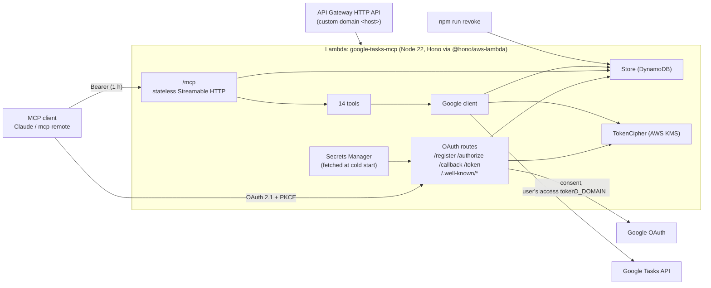

# AWS deployment of google-tasks-mcp — design

* **Status**: Draft for review, 2026.W43 (2026-10-23)
* **Authors**: YC Lian, Claude
* **Repo**: `github.com/yclian/google-tasks-mcp` (fork of `akutishevsky/google-tasks-mcp`)
* **Related**: [`docs/specs/2026-10-17-gcp-deployment-design.md`](2026-10-17-gcp-deployment-design.md) (the GCP sibling), `docs/adr/adr-001-central-encrypted-token-store.md`

## 1. Goal

One shared Google Tasks MCP server for the users of a Google Workspace domain, on
**AWS Lambda behind an API Gateway HTTP API** at `https://<host>`, usable from
Claude (web, Desktop, Code) and `mcp-remote` clients. Each user signs in with
their own `@<domain>` Google account and reaches only their own tasks.

The AWS backends are a strictly **additive** option on the same codebase: with
none of the new AWS environment variables set, the server behaves exactly as it
does today (`STORAGE=denokv`, `CIPHER=static`). The GCP mode, the Node/container
mode and the Deno Deploy mode are untouched.

### Public repo, private values

This spec, the code and `infra-aws/` are public and generic. Values specific to
one deployment (region, domain, hostname, Terraform state bucket, KMS key, secret
ARN) are placeholders here (`<region>`, `<domain>`, `<host>`) and supplied at
deploy time through an untracked `terraform.tfvars`, `terraform init
-backend-config=…` and environment variables.

### Success criteria

| # | Criterion |
|---|-----------|
| AC1 | Several users connect concurrently; each tool call reaches Google with that user's own credentials. |
| AC2 | A user stays connected across cold starts, deploys and scale-to-zero. |
| AC3 | With `ALLOWED_DOMAIN` set, only accounts in that Workspace domain can complete login. |
| AC4 | No re-login for 30 days of normal use; access-token expiry is invisible to the user. |
| AC5 | An admin can revoke one user, or everyone, with one command. |
| AC6 | A leak of the DynamoDB data alone exposes no usable credential. |
| AC7 | With none of the new settings, behaviour matches upstream (Deno KV, `ENCRYPTION_SECRET`, open to any Google account). |
| AC8 | The deployed service connects from Claude web, Claude Code and `mcp-remote`. |

## 2. Findings that drive the design

The application-level findings are shared with the GCP design (see its §2): Deno
KV is in-memory on Node, the central encrypted token store, stateless Streamable
HTTP, refresh rotation, redirect-URI validation, protected-resource metadata. The
AWS-specific findings are:

* **Lambda is request-scoped and stateless.** Each invocation handles one HTTP
  request; nothing survives in memory reliably across invocations, which fits the
  stateless Streamable HTTP transport (`sessionIdGenerator: undefined`,
  `enableJsonResponse: true`) the fork already uses. The Store holds all state.
* **`@hono/aws-lambda` adapts the existing Hono app unchanged.** `handle(app)`
  gives a plain stateless JSON handler; the 14 tools and the OAuth routes reuse
  `createApp`/`buildDeps` without forking.
* **The OAuth issuer and redirect URI must be stable from day one.** They are
  baked into every connector, so the public entry is the custom domain, not a
  per-deploy API Gateway URL or a Lambda Function URL.
* **DynamoDB mirrors Firestore cleanly.** A single table with a string partition
  key and sort key reproduces the `Store` contract; a numeric `ttl` attribute
  gives DynamoDB TTL for garbage collection while the server still checks
  `expiresAt` on every read.

## 3. Decisions

| Area | Decision | Rejected, and why |
|------|----------|-------------------|
| Runtime | **AWS Lambda (Node 22, `nodejs22.x`)** with `@hono/aws-lambda` plain `handle(app)` — stateless JSON, scales to zero. Handler `index.handler`, artifact bundled by esbuild to `build/lambda/index.mjs`. | A container on ECS/Fargate: always-on cost and more to operate for a bursty, low-traffic shared server. |
| Public entry | **API Gateway HTTP API** (`$default` route, `AWS_PROXY` integration, payload format 2.0) with an **API Gateway v2 custom domain** from day one. **No CloudFront, no Lambda Function URL.** | *CloudFront*: an extra distribution and cache layer in front of an already-TLS HTTPS API, for no benefit to a stateless OAuth server. *Function URL as the public entry*: it ties the stable hostname to the function and offers less routing control than API Gateway; the custom domain on API Gateway gives the fixed issuer/redirect host that connectors require. |
| Transport | SDK `WebStandardStreamableHTTPServerTransport`, stateless (shared with all modes). | Stateful sessions: Lambda has no sticky in-memory session. |
| Storage | `Store` interface; `STORAGE=dynamodb` selects `DynamoDbStore`, a **single-table** store mirroring `FirestoreStore`. Low-level `@aws-sdk/client-dynamodb` + `@aws-sdk/util-dynamodb` (not the DocumentClient) for explicit `ConditionExpression`/`ReturnValues` in `take`. | DocumentClient: hides the conditional-delete control `take` needs for a single concurrent winner. |
| Encryption | `TokenCipher` interface; `CIPHER=awskms` selects `AwsKmsCipher`, which calls KMS `Encrypt`/`Decrypt` per token (tokens are well under the 4 KiB direct-encrypt limit). | Envelope encryption: more code for no gain at this token size. |
| Secrets | **One Secrets Manager JSON secret** `{ client_id, client_secret }`, fetched at cold start by `src/lambda.ts` and injected into `process.env` **before** `loadConfig`. `config.ts` stays env-only. | Two separate secrets: more resources and two reads; one JSON blob matches the single-secret decision. Reading in `config.ts`: would break the env-only contract. |
| State backend | **S3 + DynamoDB** Terraform backend (`backend "s3" {}`, config at init). | Local state for shared infra: no locking, easy to clobber. |
| Execution role | **Least-privilege** inline policy: DynamoDB `GetItem`/`PutItem`/`DeleteItem`/`Query` on the table (and its indexes), KMS `Encrypt`/`Decrypt` on the one key, `secretsmanager:GetSecretValue` on the one secret, plus `AWSLambdaBasicExecutionRole` for CloudWatch Logs. | Managed broad policies: more access than the function needs. |
| Hostname | Custom `<host>` from day one via the API Gateway v2 custom domain + ACM certificate (DNS validation). | Start on the API Gateway default URL: issuer and redirect URI are baked into every connector; migrating forces reconnects. |
| Deploy | Manual `terraform` + `aws lambda update-function-code` runbook in `DEPLOY.aws.md`; CI is left to each deployer. | A bundled CI pipeline: ties the fork to one CI vendor. |

## 4. Architecture

Every request is self-contained: the Store (DynamoDB) holds all state, so any
Lambda invocation can serve any request and scale-to-zero is safe.

## 5. Components

The application components (`Store`, `TokenCipher`, token model, OAuth routes,
transport, Google client, rate limiter, revoke command) are exactly those in the
GCP design §5 — the AWS mode reuses them unchanged. The AWS-specific pieces:

### 5.1 `DynamoDbStore` (`src/store/dynamodb.ts`)

Mirrors `FirestoreStore`. `key[0]` → the partition key `pk`; `key.slice(1)` → the
sort key `sk`, encoded by a reversible, collision-free, prefix-ordered scheme (the
same percent-encoding as the Firestore doc-id encoder, parts joined with `~`).
Items: `{ pk, sk, v, expiresAt (ms | null), ttl (epoch seconds, written only when
a TTL is set) }`. `get`/`list` check `isLive(env, clock)`; the DynamoDB TTL on
`ttl` is garbage collection only. `take` is a `DeleteItem` with
`ConditionExpression attribute_exists(pk)` and `ReturnValues ALL_OLD`, so exactly
one concurrent caller receives the old image. `list` is a `Query` on `pk` with
`begins_with(sk, prefix)` when there are extra parts, paginating
`LastEvaluatedKey`. Uses `marshall`/`unmarshall` from `@aws-sdk/util-dynamodb`
(low-level client, not the DocumentClient). `guard()` maps throttling/unavailable
(`ProvisionedThroughputExceededException`, `ThrottlingException`,
`RequestLimitExceeded`, `InternalServerError`, 500/503) to
`BackendUnavailableError('dynamodb', …)`.

### 5.2 `AwsKmsCipher` (`src/crypto/awskms.ts`)

Mirrors `KmsCipher`. An injectable `AwsKmsClientLike` seam exposes the two calls
the cipher makes: `encrypt({ KeyId, Plaintext }) → { CiphertextBlob }` and
`decrypt({ CiphertextBlob }) → { Plaintext }`. `encrypt` returns base64 of the
blob; `decrypt` returns the UTF-8 plaintext. `guard()` maps
`ThrottlingException`/`KMSInternalException`/500/503 to
`BackendUnavailableError('kms', …)`, letting `InvalidCiphertextException` and
wrong-key errors throw.

### 5.3 Lambda entrypoint (`src/lambda.ts`)

At module top level, if `GOOGLE_OAUTH_SECRET_ID` is set, lazy-import
`@aws-sdk/client-secrets-manager`, `GetSecretValue` for that id, `JSON.parse` the
`{ client_id, client_secret }` body, and set `GOOGLE_CLIENT_ID`/
`GOOGLE_CLIENT_SECRET` in `process.env` **before** `loadConfig(process.env)` — so
`config.ts` stays env-only. Then `const app = createApp(await
buildDeps(loadConfig(process.env)))` and `export const handler = handle(app)` from
`@hono/aws-lambda` (plain, stateless). With no AWS env the module imports cleanly
(local/test), doing no secret fetch.

## 6. Configuration

| Env var | Default (upstream) | AWS value |
|---------|--------------------|-----------|
| `GOOGLE_CLIENT_ID` / `GOOGLE_CLIENT_SECRET` | required | injected from the Secrets Manager JSON at cold start |
| `GOOGLE_OAUTH_SECRET_ID` | unset | the Secrets Manager secret ARN (read only by `src/lambda.ts`) |
| `GOOGLE_REDIRECT_URI` | `http://localhost:3000/callback` | `https://<host>/callback` |
| `ISSUER_URL` | request origin | `https://<host>` |
| `STORAGE` | `denokv` | `dynamodb` |
| `DYNAMODB_TABLE` | — | the table name |
| `CIPHER` | `static` | `awskms` |
| `ENCRYPTION_SECRET` | required for `static` | — |
| `AWS_KMS_KEY_ID` | — | the KMS key ARN |
| `AWS_REGION` | — | the function region (also used by the DynamoDB/KMS/Secrets Manager clients) |
| `ALLOWED_DOMAIN` | unset (any account) | `<domain>` |
| `ALLOWED_REDIRECT_URIS` | unset (any https/loopback URI) | `loopback,https://claude.ai/api/mcp/auth_callback,https://claude.com/api/mcp/auth_callback` |
| `TRUST_PROXY_HOPS` | unset | `1` |
| `PUBLIC_PAGES` | `true` | `auto` |
| `ANALYTICS`, `LOG_LEVEL` | as upstream | `false`, `info` |

Startup fails fast on an invalid combination (e.g. `STORAGE=dynamodb` without
`DYNAMODB_TABLE`, or `CIPHER=awskms` without `AWS_KMS_KEY_ID`).

## 7. Error handling

Identical to the GCP design §7, with the backend names mapped to AWS: DynamoDB or
KMS throttling/unavailability surfaces as a 503 with a generic body and a
component-tagged log line (`BackendUnavailableError('dynamodb' | 'kms', …)`); all
other situations (401 + `WWW-Authenticate`, grant deletion, Google API errors as
tool `isError`, domain mismatch 403, unknown client/redirect 400) are unchanged.

## 8. Infrastructure (`infra-aws/`)

Terraform, AWS provider (`~> 5.0`), S3 + DynamoDB state backend. `region`,
`issuer_url`, `allowed_domain`, `custom_domain` are variables with no committed
values; the backend is passed with `terraform init -backend-config=backend.hcl`.
`.gitignore` excludes `infra-aws/*.tfvars` (except `terraform.tfvars.example`),
`backend.hcl`, `.terraform/`, `.terraform.lock.hcl` and `*.tfstate*`.

| Resource | Notes |
|----------|-------|
| DynamoDB table `google-tasks-mcp` | single table, `pk` (S, HASH) + `sk` (S, RANGE), `PAY_PER_REQUEST`, TTL on `ttl`, point-in-time recovery |
| KMS key + alias `alias/google-tasks-mcp-tokens` | key rotation on; role gets Encrypt/Decrypt on this key only |
| Secrets Manager `google-tasks-mcp-google-oauth` | created empty; the operator adds the JSON version out of band |
| IAM role `google-tasks-mcp-lambda` | assume-role for `lambda.amazonaws.com`; inline least-privilege (DynamoDB item ops + Query, KMS Encrypt/Decrypt, Secrets Manager GetSecretValue) + `AWSLambdaBasicExecutionRole` |
| Lambda `google-tasks-mcp` | `nodejs22.x`, handler `index.handler`, env from §6; code deployed out of band (ignored in lifecycle) |
| API Gateway HTTP API + `$default` route + `$default` stage | `AWS_PROXY` integration (payload 2.0) to the Lambda; `aws_lambda_permission` for `apigateway.amazonaws.com` |
| ACM certificate + API Gateway v2 custom domain + mapping | behind `enable_custom_domain`; outputs the ACM validation CNAMEs and the custom-domain target to create in DNS |

Manual one-offs, recorded in `DEPLOY.aws.md`: OAuth consent screen (Internal),
OAuth client (web, redirect `<ISSUER_URL>/callback`), the single JSON secret
version, and the custom-domain/ACM DNS records.

## 9. Deploy and operate

* `DEPLOY.aws.md`: two-phase first apply (the secret before the Lambda), the
  one-off OAuth client and `aws secretsmanager put-secret-value`, build + deploy
  (`npm run build:lambda`, zip `build/lambda/`, `aws lambda
  update-function-code`), the custom-domain DNS, and the no-browser curl checks.
* `MAINTAIN.md`: endpoints, config table, revoke runbook (`npm run revoke` works
  against DynamoDB + KMS via the same env vars), connector gotchas. KMS rotation
  is automatic.
* Connector set-up note for users: add `https://<host>/mcp` as a custom connector.

## 10. Upstream strategy

The AWS backends ship as a fork-only "AWS option" PR, alongside the GCP "gcloud
option": `DynamoDbStore` + `AwsKmsCipher` + the Lambda entrypoint behind the same
`Store`/`TokenCipher` interfaces, plus `infra-aws/`, `DEPLOY.aws.md` and this
spec. It depends only on the already-upstreamable interface PRs (Store/TokenCipher
abstractions, config module); the cloud-specific code is offered but carried in
the fork if declined. Nothing in the AWS mode changes the default behaviour.

## 11. Testing

Same doctrine as the GCP design §11: scenario-and-oracle testing on **vitest**
with **fast-check**; nothing under `src/` is mocked; Google is replayed from
recorded fixtures through the `fetch` seam; time is injected through a clock seam.
The AWS third-party edges are faithfully faked, not mocked out of `src/`:

* **DynamoDB store tier.** `test/store/dynamodb.test.ts` runs the shared
  `runStoreSuite` against **DynamoDB Local** in Docker (single table: `pk` S HASH,
  `sk` S RANGE, `PAY_PER_REQUEST`, TTL on `ttl`). When Docker is absent the tier
  reports **NOT RUN** (never a silent skip) and **fails under `CI=true`**, exactly
  like the Firestore emulator tier. A `buildDeps` AWS-option test constructs
  `DynamoDbStore` + `AwsKmsCipher` from `testConfig` and round-trips a value.
* **`AwsKmsCipher` property tests.** `test/support/aws-kms-fake.ts` is a faithful
  fake: real AES-256-GCM under a random key, the `keyId` bound as AAD, tamper
  detection, and `failNext(name)` to simulate throttling/unavailability.
  `test/unit/aws-kms-cipher.test.ts` covers round-trip, ciphertext-hides-plaintext,
  tamper, wrong-key, unavailable-maps-to-backend-error, and a 503-through-the-app
  case.
* **Key encoding.** `test/unit/dynamodb-key.test.ts` property-tests the sort-key
  encode/decode (round-trip, no collisions, prefix order).
* **Config.** `test/unit/config.test.ts` adds `dynamodb_requires_table`,
  `awskms_requires_key`, `awskms_does_not_need_static_secret`, and confirms the
  defaults still match upstream (`denokv` + `static`).
* **Lambda entry.** `test/lambda-entry.test.ts` imports `src/lambda.ts` with no AWS
  env and asserts `handler` is a function and no secret fetch occurred.

## 12. Out of scope

* Personal single-user instances (default settings + `KV_PATH`).
* CI pipelines and any one organisation's deployment values.
* New tools or changes to tool behaviour.
* CloudFront, multi-region, Lambda Function URL public entry, and KMS key-version
  re-encryption jobs.

## 13. Risks

| Risk | Mitigation |
|------|------------|
| DynamoDB TTL deletion lags (up to 48 h) | Reads check `expiresAt` against the injected clock (§5.1). |
| KMS latency/throttling on the hot path | Per-grant decrypted-token cache (shared app behaviour); `guard()` surfaces throttling as 503, not 500. |
| Cold-start secret fetch adds latency to the first request | One `GetSecretValue` per cold start, then cached in `process.env` for the container's life. |
| Custom-domain / ACM validation blocks day-one hostname | Fall back to the API Gateway default URL, accept one reconnect at cutover. |
| DynamoDB Local unavailable on a dev machine | Tier reported as NOT RUN; required under CI. |
| Lambda code and Terraform drift (code deployed out of band) | `lifecycle.ignore_changes` on `filename`/`source_code_hash`; `aws lambda update-function-code` owns rollouts. |
